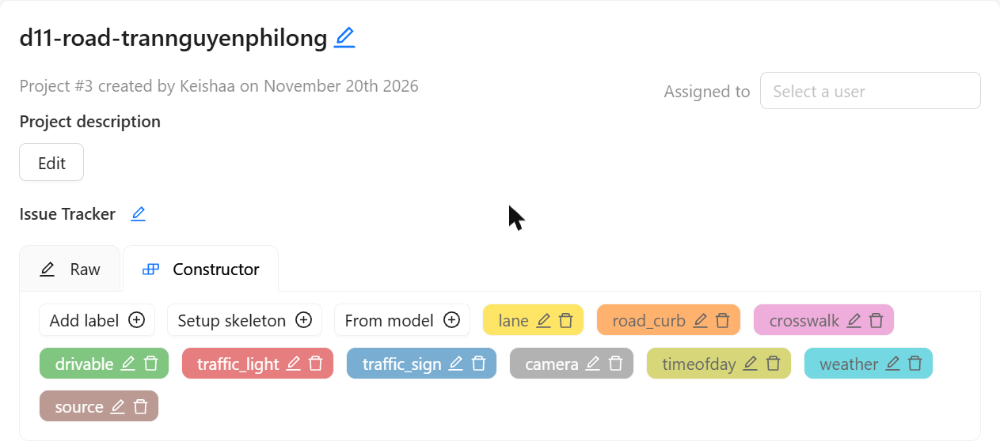
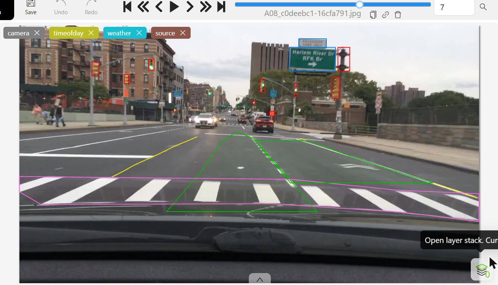
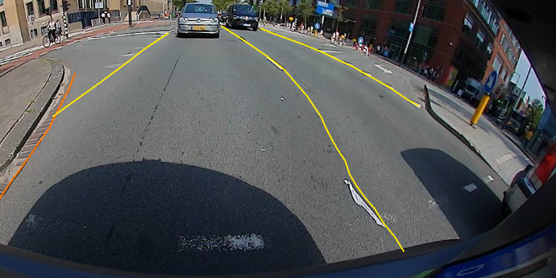
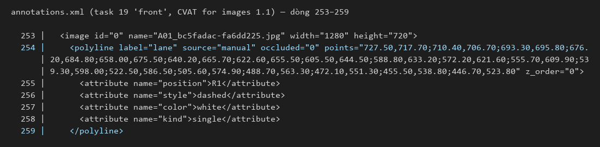

# Báo cáo cá nhân — Ngày 11
Họ tên: Trần Nguyễn Phi Long    Mã học viên: 2A202604058  
Phiên bản CVAT (Help → About): 2.74.1 (server `localhost:8080`, project `d11-road-trannguyenphilong`)  
Guideline: Road v1.0    Lần nộp (`revision` trong manifest): 1  
Thời điểm export (ngày giờ trên CVAT): 20/11/2026 16:47–16:48 (trường `<dumped>` trong XML)    Số lần nộp lại sau Rework: 0  

## 1. Kiểm project
| Mục | Đúng như guideline Road v1.0? | Ghi chú |
| --- | --- | --- |
| 6 label, đúng kiểu | Có | lane, road_curb: polyline; crosswalk, drivable: polygon; traffic_light, traffic_sign: rectangle. Đã so `<meta>` của cả 4 task với `configs/road_v1_labels.json`, không lệch |
| Thuộc tính và giá trị | Có | position, style, color, kind, area_type, các thuộc tính của đèn và biển: tên và danh sách giá trị khớp từng mục |
| 4 tag ảnh | Có | camera, timeofday, weather, source; cả 28 ảnh đều có đủ 4 tag |

Cách kết thúc polyline trên bản CVAT này: click từng điểm trên tâm vệt sơn, bắt đầu từ phía gần xe (đáy ảnh) rồi đi ra xa, xong thì bấm phím **N**.  
Cách đặt tag ảnh trên bản CVAT này: dùng công cụ Tag ở thanh bên trái, đặt `camera` trước rồi đến `timeofday`, `weather`, `source`. Sau đó mở **Details** trong bảng Objects để chọn `value`, vì CVAT tự điền giá trị đầu tiên của danh sách.

## 2. Số lượng đã gán
| Task | Ảnh | lane | road_curb | crosswalk | drivable | traffic_light | traffic_sign |
| --- | ---: | ---: | ---: | ---: | ---: | ---: | ---: |
| front | 12 | 29 | 3 | 4 | 24 | 24 | 19 |
| front-extra (đã làm 4 / 4) | 4 | 11 | 0 | 2 | 6 | 5 | 8 |
| fisheye | 8 | 8 | 3 | 8 | 5 | 2 | 0 |
| fisheye-extra (đã làm 4 / 4) | 4 | 0 | 0 | 4 | 2 | 0 | 0 |

## 3. Bảng ca khó
| Ảnh | Nhãn | Phân vân giữa | Đã chọn | Lý do |
| --- | --- | --- | --- | --- |
| A05 | lane L1, R1 | Vẽ L1/R1 theo mép xe đỗ hoặc để trống | Không vẽ lane; chỉ vẽ drivable direct và road_curb | Đường phố không có vạch sơn nào. Guideline chỉ vẽ lane trên vệt sơn; vẽ thêm vạch sẽ thành nhãn thừa. Lint báo QC1-02, chờ coach xác nhận để được miễn |
| A07 | lane L1 | Lấy dải bê tông bên trái làm L1 hoặc để trống | Không vẽ L1; R1 là vạch trắng liền, R2 là vạch trắng đứt | Bên trái làn xe là dải phân cách bê tông, không có vệt sơn. Lint báo QC1-02, chờ coach xác nhận |
| A12 | lane R1 | Lấy mép lề phải làm R1 hoặc để trống | Không vẽ R1; L1 là vạch trắng đứt | Bên phải làn xe chỉ có lề và hàng xe đỗ, không có vạch. Lint báo QC1-02, chờ coach xác nhận |
| A04 | lane L1, drivable | `kind` single hoặc double; tách direct/alternative hay gộp | L1 vàng liền, kind = double; drivable chia direct và alternative | Tim đường là vạch vàng đôi (1.3 → kind double). Làn bên cạnh cùng chiều nên là alternative |
| B06, B07, B08 | lane position | Dùng L1/R1 theo hướng xe hay `other` | position = other | Guideline mục 4: ở fisheye_left và fisheye_right luôn dùng position = other |
| B11 | (để trống) | Vẽ drivable cho lối đi trong bãi đỗ hay để trống | Không vẽ shape; chỉ đặt 4 tag | Ảnh camera lùi vào ô đỗ cho người khuyết tật. Ô đỗ nằm ngoài phạm vi Road v1.0 (guideline mục 0, chuyển sang v1.x ở Ngày 20); ảnh không có vạch làn hay vạch qua đường |

## 4. Phiếu QC 1 nhận được
Bạn kiểm lô của tôi: Phạm Phú Nguyên Hùng (2A202604062), phiếu `submit/phamphunguyenhung-qc1-for-trannguyenphilong.md` trong repo của bạn  Quyết định nhận được: **Hold** (0 lỗi nặng xác nhận, 2 nghi vấn mức chính / 279 nhãn = 0,7 %, 5 ca chờ lead)  
| Mã lỗi | Số lỗi | Đồng ý? | Đã sửa? |
| --- | ---: | --- | --- |
| QC1-02 (A05 L1 + R1, A07 L1, A12 R1) | 3 ảnh (nghi vấn) | Không. Ba ảnh này không có vệt sơn ở phía bị thiếu: A05 là phố không kẻ vạch, A07 bên trái là dải bê tông, A12 bên phải chỉ có lề và xe đỗ. Vẽ thêm vạch sẽ thành nhãn thừa (QC1-03). Lý do đã ghi ở mục 3; chờ coach xác nhận để được miễn. | Không sửa (giữ nguyên theo guideline) |
| QC1-03 / QC1-04 (A12 lane L1 #11) | 1 (nghi vấn) | Một phần. Đây là vạch đứt trắng thật sau vạch qua đường, không phải nhãn thừa (phóng to thấy rõ các đoạn đứt). Nhưng polyline dừng ở y ≈ 400, trong khi đoạn đứt còn thấy tới khoảng (542,380). | Chưa: kéo dài L1 tới đoạn đứt xa nhất rồi export lại |
| QC1-04 (A06 lane L1 #7) | 1 (nghi vấn) | Có. Vạch vàng còn thấy thêm khoảng 10 px ở hai đầu: bắt đầu từ khoảng (428,416) và kéo tới khoảng (478,393). Polyline hiện tại đi từ (442,416) tới (470,399). | Chưa: nối dài hai đầu rồi export lại |
| QC1-04 (A07 lane R2 #1) | 1 (nghi vấn) | Không. Polyline 23 điểm bám đúng tâm vạch trắng chạy dọc bánh xe tải, từ (1199,453) tới (797,294); vạch nằm sát xe tải nên trông như đi qua bánh xe. Khi phóng to để kiểm, tôi lại tự phát hiện vạch này có vẻ là vạch **liền**, trong khi đang gán `style = dashed` (QC1-06, phiếu không ghi). | Chưa: mở lại A07 trên CVAT, đổi `style` nếu đúng là vạch liền |
| QC1-11 / QC1-07 (B11 chưa có shape) | 1 (ca mơ hồ) | Không. B11 là camera lùi vào ô đỗ cho người khuyết tật; ô đỗ nằm ngoài phạm vi Road v1.0 và ảnh không có vạch làn hay vạch qua đường (đã ghi ở mục 3). Chờ lead xác nhận. | Không sửa |

Phản hồi về phiếu: bạn đã kiểm đủ 28 ảnh ở mức dữ liệu nhưng chỉ xem overlay 5 ảnh, và để "chưa kiểm" ở QC1-05, 06, 08, 09, 10. Lỗi QC1-06 ở A07 mà tôi tự tìm ra thuộc đúng nhóm chưa kiểm này. Sau khi sửa ba polyline trên (A06, A12, A07), tôi export lại và nộp `--revision 2`.

## 5. Kiểm file export
| File | Mở lại được? | Số shape ảnh 1 (job / file) | Số shape ảnh 2 (job / file) | Tag camera có trong XML? |
| --- | --- | --- | --- | --- |
| trannguyenphilong-front.zip | Có (`road_check lint`, 16 ảnh) | A01: 9 / 9 | A02: 5 / 5 | Có (`camera` = front, 16/16 ảnh) |
| trannguyenphilong-fisheye.zip | Có (`road_check lint`, 12 ảnh) | B01: 2 / 2 | B02: 4 / 4 | Có (`camera` = fisheye_*, 12/12 ảnh) |

Số shape phía job lấy từ API annotation của CVAT. Cả 4 job (17, 18, 19, 20) đều ở trạng thái `completed`; tổng shape theo job (26, 6, 103, 32) khớp với số shape trong file.  
Lint: 28 ảnh, `contains_images: false`, có 4 cảnh báo QC1-02 (A05 L1 và R1, A07 L1, A12 R1). Cả 4 cảnh báo đều là ca không thấy vạch, đã ghi ở mục 3.

## 6. Ảnh chụp màn hình
1. Tab Labels của project: đủ 6 label vẽ và 4 label tag.

   

2. Ảnh camera trước A08 đã gán đủ: lane, drivable direct/alternative, crosswalk, traffic_light, traffic_sign. Phần chữ trên canvas được ẩn đi cho dễ nhìn.

   

3. Ảnh fisheye B03 (fisheye_rear), phóng to đoạn polyline cong bám theo cung vạch, cùng road_curb bên trái.

   

4. Đoạn XML có `<polyline label="lane">` trong file export của task front (ảnh A01, vạch R1).

   

## 7. Tự đánh giá
Lỗi bạn mắc nhiều nhất hôm nay (theo mã QC1-xx), và cách tránh ở Ngày 20: Lint chỉ báo QC1-02 (thiếu L1/R1) ở A05, A07, A12, nhưng đây là các ảnh không có vạch sơn, nên không phải lỗi gán nhãn. Nguy cơ lớn nhất của tôi là chỗ CVAT tự điền giá trị đầu tiên cho tag và thuộc tính (ví dụ `weather=clear`, `position=L1`). Lint không bắt được loại lỗi này, nên nếu quên đổi sẽ thành sai QC1-01/QC1-03 mà không ai báo. Ngày 20 tôi sẽ đặt tag `camera` trước, kiểm Details của từng shape ngay sau khi vẽ, và trước khi export thì lọc theo `position` để soát lại L1/R1 trên từng ảnh. *(Cập nhật lại khi nhận được Phiếu QC 1.)*  
Nhãn của bạn đi vào model ở đâu? Chọn một lỗi đã sửa và nói nó làm model học sai thế nào:
- `lane` (polyline) được đổi thành đích row-anchor: mỗi hàng y có một giá trị x hoặc "không có làn". Đây là dữ liệu huấn luyện cho model phát hiện làn mà LKA dựa vào.
- `drivable` direct/alternative thành mask cho model phân vùng vùng lái.
- `traffic_light`/`traffic_sign` thành box cho model phát hiện vật thể.
- Tag `camera` quyết định ảnh nằm ở tập front hay fisheye.

Ví dụ: nếu tôi vẽ thêm một R1 giả ở A12 theo mép lề, model sẽ học rằng mép lề cũng là vạch làn. Ngược lại, nếu bỏ sót R1 ở ảnh có vạch thật, mọi hàng của vạch đó thành "không có làn" và model học bỏ qua vạch phải; khi đó LKA mất biên phải của làn đang đi. *(Thay bằng một lỗi đã sửa thật sau khi nhận phiếu QC 1.)*  

## 8. (Tùy chọn, buffer) Từ polyline đến đích row-anchor
Ảnh A01, vạch R1 (trắng đứt), lấy từ `python -m road_lab.rowanchor trannguyenphilong-front.zip --image A01`.

| y | 720 | 680 | 640 | 600 | 560 |
| --- | ---: | ---: | ---: | ---: | ---: |
| x của chúng tôi | không có làn | 666.8 | 598.8 | 542.1 | 484.1 |
| x của bạn kia |  |  |  |  |  |

1. Polyline R1 của A01 bắt đầu ở y = 717.7 nên hàng 720 đã là "không có làn", và kết thúc ở y = 523.8. Nếu dừng sớm 40 px (điểm cuối khoảng y = 563.8) thì hàng **560** đổi thành "không có làn". Các hàng 680, 640, 600 vẫn còn.
2. *(Điền sau khi có file của bạn được kiểm.)*
3. Giá trị x không đổi, vì `rowanchor` nội suy tuyến tính giữa hai điểm kẹp hàng y, không phụ thuộc thứ tự điểm. Chỗ gặp khó là `road_check`: nó kiểm chiều "gần ra xa" (QC1-04) và sẽ báo lỗi. `rowanchor` cũng in cảnh báo "vẽ từ xa về gần". Ngoài ra, script nào coi điểm đầu là điểm gần xe nhất (để nối dài vạch xuống đáy ảnh hay lấy điểm xuất phát của làn) sẽ lấy nhầm đầu xa.
